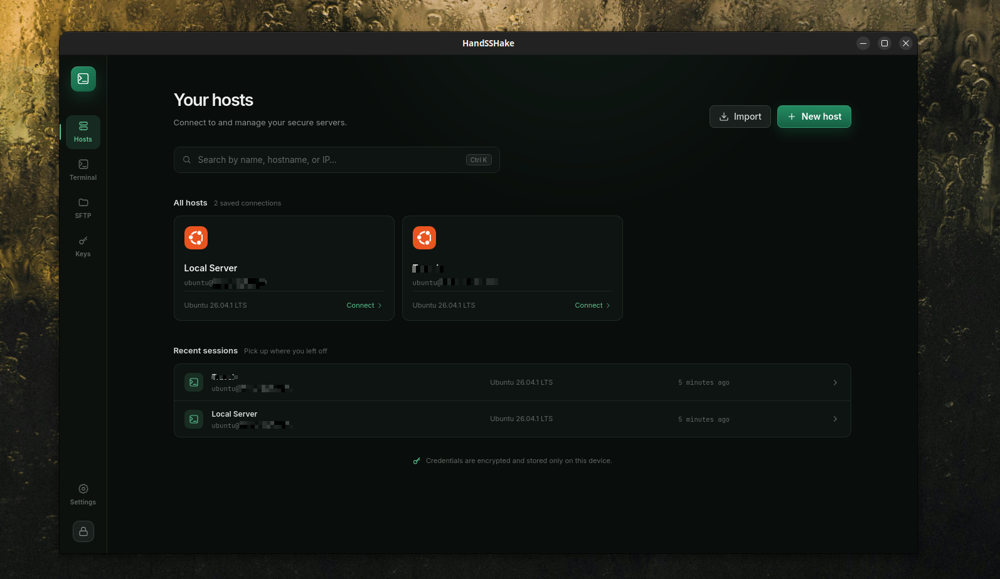
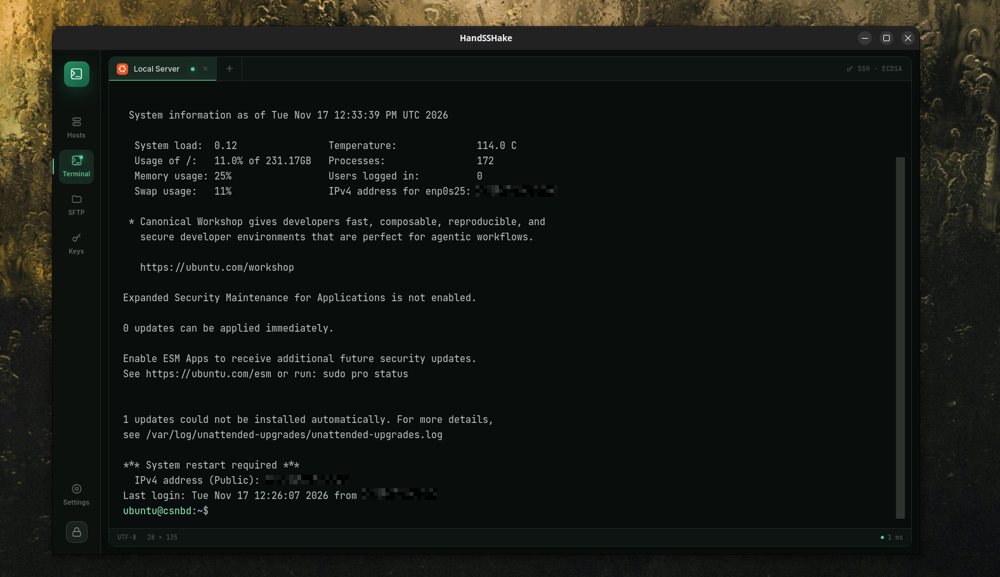
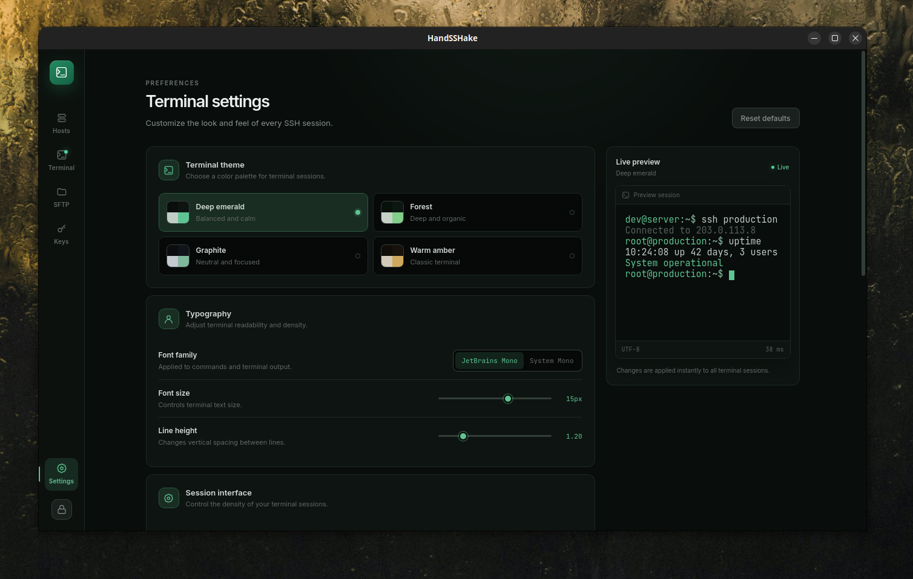
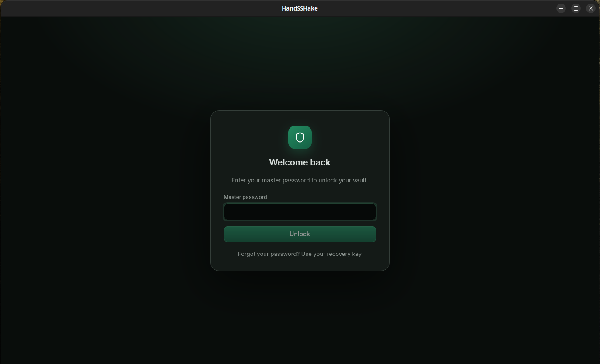

# HandSSHake

**A clean, fast, and secure SSH client for your desktop.**

HandSSHake is a desktop SSH client designed to make managing remote connections simple and convenient. It provides a tabbed terminal experience, encrypted local credential storage, and secure authentication — all in one desktop application.

Your SSH hosts and credentials stay on your machine, protected by an encrypted local vault.

## Preview



## Features

- **Tabbed SSH terminals** – Manage multiple SSH sessions in separate tabs using xterm.js.
- **Encrypted local vault** – Protect saved hosts and credentials using Argon2id and XChaCha20-Poly1305.
- **Recovery key** – A dedicated recovery mechanism to restore access to your encrypted vault.
- **Multiple authentication methods** – Connect using passwords or SSH private keys, including passphrase-protected keys.
- **Host key verification** – Verify remote server identities through a trust-on-first-use (TOFU) prompt.
- **Quick host search** – Find saved SSH connections instantly with `Ctrl + K`.

### SSH Terminal




### Settings



## Platforms

HandSSHake currently supports:

| Platform | Distribution |
|---|---|
| Linux | `.deb` package |
| macOS | `.dmg` package |

Windows is not currently supported.

## Installation

Download the latest release for your operating system from [GitHub Releases](https://github.com/orchid0610/handsshake/releases).

### Linux

Download the `.deb` package and install it:

```bash
sudo apt install ./handsshake_*.deb
```

### macOS

Download the `.dmg` package, open it, and move HandSSHake into your Applications folder.

## Privacy & Security

HandSSHake is designed with local-first storage and offline operation in mind.

- SSH hosts and credentials are stored locally in an encrypted vault.
- Vault encryption uses Argon2id and XChaCha20-Poly1305.
- A recovery key mechanism is provided for vault recovery.
- SSH server identities are verified through a trust-on-first-use (TOFU) process.
- No internet connection is required for application functionality beyond establishing SSH connections.

### Encrypted Vault



## Development

### Requirements

- Go
- Node.js
- Wails v2 CLI
- Ubuntu: `libwebkit2gtk-4.1-dev`

### Getting started

Clone the repository:

```bash
git clone https://github.com/orchid0610/handsshake.git
cd handsshake
```

Start the development server:

```bash
make dev
```

### Available commands

| Command | Description |
|---|---|
| `make dev` | Run the application with live reload |
| `make test` | Run Go tests |
| `make build` | Build a release binary into `build/bin` |

## Contributing

Contributions, bug reports, and feature suggestions are welcome.

Please open an issue before submitting major changes.

## License

HandSSHake is open source and available under the [MIT License](LICENSE).